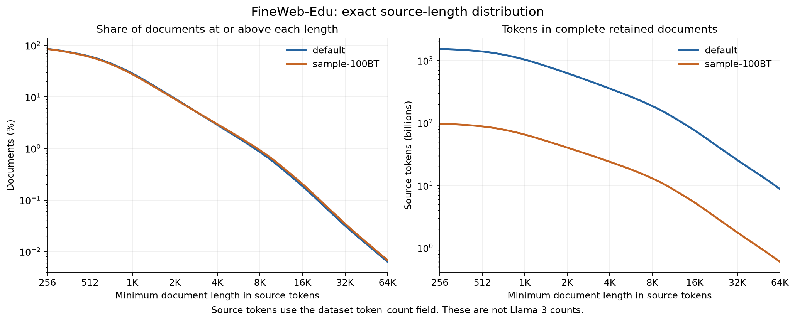

# FineWeb-Edu source statistics

[Overview](README.md)

Source: `HuggingFaceFW/fineweb-edu`.
Revision: `87f09149ef4734204d70ed1d046ddc9ca3f2b8f9`.
The scan counted every row in sample-100BT and default.
It read the source `token_count` field. It did not retokenize text with Llama 2 or Llama 3.
These counts precede our duplicate removal and data split.

## Document lengths

All lengths and totals use source token units.
The program uses linear interpolation for percentiles.

| Metric | sample-100BT | default |
| --- | ---: | ---: |
| Documents | 97,270,686 | 1,525,223,056 |
| Total tokens | 100,355,779,513 | 1,582,636,646,687 |
| Minimum | 31 | 29 |
| Maximum | 287,742 | 377,874 |
| Mean | 1,031.72 | 1,037.64 |
| Median | 629.00 | 645.00 |
| P90 | 1,929.00 | 1,962.00 |
| P95 | 2,952.00 | 2,952.00 |
| P99 | 7,837.00 | 7,511.00 |
| P99.9 | 21,690.31 | 20,954.00 |

The two configurations have similar length distributions.
Default supplies more long documents because it contains more documents overall.

The left plot shows the percentage of documents at or above each length.
The right plot shows all tokens in those complete documents.
Both plots use logarithmic axes.

## Documents at or above each threshold

Each token total includes the full length of every matching document.
These rows overlap. They do not give usable labels after window division.
B means one billion tokens.

| Minimum length | 100BT documents | 100BT tokens (B) | Default documents | Default tokens (B) |
| ---: | ---: | ---: | ---: | ---: |
| 1,024 | 26,743,079 | 65.436 | 434,456,010 | 1037.206 |
| 2,048 | 8,817,588 | 40.462 | 141,868,863 | 628.780 |
| 4,096 | 2,866,678 | 23.982 | 43,488,199 | 356.647 |
| 8,192 | 897,438 | 13.003 | 12,981,802 | 187.389 |
| 16,384 | 199,093 | 5.309 | 2,830,375 | 75.779 |
| 32,768 | 33,905 | 1.771 | 487,026 | 25.550 |
| 65,536 | 6,610 | 0.600 | 96,478 | 8.741 |

Default also has these intermediate thresholds.

| Minimum length | Documents | Tokens in complete documents (B) |
| ---: | ---: | ---: |
| 12,288 | 5,530,192 | 113.643 |
| 20,480 | 1,618,178 | 53.725 |
| 24,576 | 1,007,984 | 40.120 |
| 28,672 | 681,718 | 31.497 |
| 40,960 | 284,962 | 18.212 |
| 49,152 | 188,472 | 13.902 |

For example, 100BT documents with at least 4,096 tokens contain about 23.982B tokens in total.
This value is a token count, not a document count.
Default documents with at least 32,768 tokens contain about 25.550B source tokens.
Tokenization, duplicate removal, validation exclusions, and incomplete tails change the available training budget.
A long record does not establish content quality or a need for long context.

## Exact results

- [100BT report](../../outputs/fineweb_edu_profile/full-100bt/report.json): exact totals, percentiles, buckets, and window counts.
- [Default report](../../outputs/fineweb_edu_long/full-default-profile/report.json): exact totals and additional thresholds.
- [Construction and evidence](appendix/construction.md): scan coverage, file checks, and storage locations.
